# 분필 배포와 환경변수

> README에서 옮긴 배포 절차와 환경변수 표입니다(2026-10-08). 현재 배포 방식은 Render 무료(백엔드) + Vercel Hobby(프론트엔드)이고, 기존 EC2 절차는 "대안: EC2 배포"에 남겨 뒀습니다.

## 배포 (Render + Vercel, 무료)

> **현재 배포 방식은 Render 무료 플랜(백엔드) + Vercel Hobby(프론트엔드)입니다**(2026-10-19 결정, EC2 비용 때문).
> 기존 EC2 + Caddy 절차는 아래 "대안: EC2 배포"에 그대로 남겨 뒀습니다. 운영 모델은 전부 API라서
> RunPod 서버리스는 2026-10 이후 쓰지 않습니다.

구성: 교사 브라우저 → Vercel(Next.js) → Render(FastAPI, singapore) → OpenRouter/OpenAI.
Vercel 함수가 서버 측에서 Render를 호출하므로 `BUNPIL_API_KEY`는 브라우저에 노출되지 않습니다.
두 플랫폼이 HTTPS를 제공하므로 Caddy와 DNS 설정은 필요 없습니다.

### 사전 준비

OpenRouter 키에는 월 지출 한도를, OpenAI에는 사용 한도를 설정하는 것을 권장합니다. Vercel 주소를 아는 사람은 누구나
출제를 돌릴 수 있기 때문입니다. 동시 2건 제한 기준으로 쉬지 않고 돌려도 시간당 약 240건, 약 $2.5가 상한입니다
(요청당 약 $0.0104, 2026-10-18 로컬 부하 테스트 실측).

### Render (백엔드)

1. 이 저장소를 `main`에 push합니다.
2. Render 대시보드에서 New → Blueprint로 저장소를 연결합니다(루트의 `render.yaml` 사용).
3. `OPENROUTER_API_KEY`, `OPENAI_API_KEY`를 입력합니다(`sync: false`라 git에는 남지 않습니다).
4. `BUNPIL_API_KEY`는 Render가 생성합니다. 서비스의 Environment 탭에서 값을 확인합니다.

`autoDeployTrigger: checksPass`라서 `.github/workflows/ci.yml`이 통과한 커밋만 자동 배포됩니다.
LangSmith 트레이싱을 켜려면 대시보드에서 `LANGCHAIN_TRACING_V2=true`와 `LANGCHAIN_API_KEY`를 추가합니다.

### Vercel (프론트엔드)

1. 저장소를 Import하고 Root Directory를 `frontend`로 지정합니다.
2. 환경변수 `BACKEND_URL`(Render 서비스 주소, 예: `https://bunpil-api.onrender.com`)과 `BUNPIL_API_KEY`(Render 값을 복사)를 입력합니다.
3. Fluid compute가 켜져 있는지 확인합니다. Hobby 함수는 최대 300초이고, 출제 SSE가 이 안에 끝나야 합니다.
4. 함수 리전을 `icn1`(서울) 또는 `sin1`로 지정합니다.

### 제약

| 항목 | 내용 | 영향 |
|---|---|---|
| Render 무료 플랜 절전 | 15분 동안 요청이 없으면 정지하고, 깨우는 데 약 1분이 걸립니다 | 정지 뒤 첫 요청은 1분 30초~2분 걸릴 것으로 예상합니다(측정이 아니라 추정) |
| 메모리 512MB, CPU 0.1 | 로컬에서 같은 제한을 건 컨테이너로 측정하면 대기 254MB, 최고 289MB, 기동 52초였습니다 | `<보기>` 출제 요청은 첫 요청 39초, 두 번째 25초였습니다(2026-10-19, arm64 맥에서 측정해 Render x86과 다를 수 있음) |
| Vercel 요청 본문 4.5MB 고정 | 이미지 업로드 요청이 이 크기를 넘으면 Vercel이 거부합니다 | 프론트엔드가 4MB를 넘는 이미지를 업로드 전에 막습니다 |
| Vercel Hobby | 비상업용 플랜입니다 | 상업적 용도로는 쓸 수 없습니다 |

---

## 대안: EC2 배포 (Docker + Caddy)

<picture>
  <source media="(prefers-color-scheme: dark)" srcset="../assets/deploy-architecture-dark.svg">
  
</picture>

> **프론트엔드 배포**: `docker-compose.yml`의 `frontend` 서비스가 3000 포트로 UI를 서빙합니다
> (`frontend/Dockerfile`, Next.js `output: "standalone"` 빌드). 컨테이너 안에서는
> `frontend/app/api/*/route.ts`가 `BACKEND_URL=http://app:8765`로 FastAPI에 프록시하므로,
> Caddy는 3000만 바라보면 됩니다(아래 Caddyfile 참고). `docker compose up -d --build` 한 번으로
> `app`과 `frontend`가 함께 뜹니다.

<details>
<summary><b>EC2 대안에서 frontend만 Vercel로 분리하기 (펼치기)</b></summary>

EC2 대안 구성은 EC2 안에서 `frontend` 컨테이너를 상시 프로세스로 돌립니다.

대안으로 Next.js를 Vercel 같은 외부 호스팅에 올리고 `BACKEND_URL`만 EC2 도메인(`https://your-domain.com`)으로 맞출 수도 있습니다. 이 경우 `frontend` 컨테이너는 없어도 되고, Caddy는 FastAPI(8765)를 직접 바라보도록 되돌려야 합니다.

현재 배포 방식(위 Render + Vercel 절)은 frontend를 Vercel에 두는 구성입니다.

</details>

### RunPod 서버리스 설정

(현재 사용하지 않음: 2026-10 이후 운영 모델은 전부 API)

```bash
# 1. 핸들러 이미지 빌드 & 푸시
cd runpod_handler
docker build -t <your-dockerhub>/bunpil-runpod:latest .
docker push <your-dockerhub>/bunpil-runpod:latest

# 2. RunPod 콘솔 → Serverless → New Endpoint → 이미지 URL 입력
# 3. 워커 설정: min workers=1 (콜드스타트 방지), max workers=4 (병렬 출제 시)
# 4. 발급된 Endpoint ID를 .env에 입력
# LLM_BACKEND=runpod
# RUNPOD_API_KEY=...
# RUNPOD_ENDPOINT_ID=...
```

### EC2 배포 (Docker Hub 이미지 사용)

```bash
# EC2 (Ubuntu 22.04 t3.medium) 내부에서
docker pull jongmin0826/bunpil-app:latest
docker pull jongmin0826/bunpil-frontend:latest

# EBS 볼륨 마운트 (처음 한 번)
sudo mkfs.ext4 /dev/nvme1n1
sudo mkdir -p /data/chroma_db
echo '/dev/nvme1n1 /data/chroma_db ext4 defaults,nofail 0 2' | sudo tee -a /etc/fstab
sudo mount -a

# app과 frontend가 컨테이너 이름으로 서로 통신할 수 있도록 전용 네트워크 생성
docker network create bunpil-net

# 컨테이너 실행 (FastAPI)
docker run -d --name bunpil \
  --network bunpil-net \
  -p 8765:8765 \
  --env-file /home/ubuntu/.env \
  -v /data/chroma_db:/data/chroma_db \
  jongmin0826/bunpil-app:latest

# 컨테이너 실행 (Next.js — BACKEND_URL은 컨테이너 이름으로 접근)
docker run -d --name bunpil-frontend \
  --network bunpil-net \
  -p 3000:3000 \
  -e BUNPIL_API_KEY='<FastAPI와 동일한 값>' \
  -e BACKEND_URL=http://bunpil:8765 \
  jongmin0826/bunpil-frontend:latest

# RAG 인덱싱 (처음 한 번 — EBS에 영구 저장됨)
docker exec bunpil python scripts/index_regulations.py
docker exec bunpil python scripts/index_standards.py
```

> `docker-compose.yml`을 그대로 쓴다면(`docker compose up -d --build`) 네트워크가 자동으로 만들어지므로
> 위 `docker network create`와 `--network` 단계는 건너뛰어도 됩니다.
>
> 이때 프론트엔드는 컨테이너 이름이 아니라 compose 서비스 이름으로 백엔드를 찾으므로
> `BACKEND_URL`이 `http://app:8765`가 됩니다(위 `docker run` 예시의 `http://bunpil:8765`와 다릅니다).
>
> Docker Hub에 `bunpil-frontend` 이미지를 아직 올리지 않았다면
> `cd frontend && docker build -t jongmin0826/bunpil-frontend:latest . && docker push ...`로 먼저 푸시하세요.

### 빌링 알람

```bash
bash deploy/billing_alarm.sh   # 월 $10 초과 시 이메일 알람
```

### 월 운영비 (1인 기준)

Render + Vercel: 호스팅 $0, API 사용료만(요청당 약 $0.01). 아래 표는 EC2 대안 기준입니다.

| 항목 | 비용 |
|---|---|
| EC2 t3.medium | 약 $30 |
| RunPod 서버리스 (추론만 과금, `min workers=1`) | 약 $5~15 |
| EBS | 약 $1 |
| **합계** | **약 $36~46** |

데모나 개발 중에는 EC2를 필요할 때만 켜서 아낄 수 있습니다. `min workers=0`으로 두면 RunPod 비용을 크게 줄일 수 있습니다(대신 첫 호출에 30~60초가 더 걸립니다).

---

## 환경변수

`.env.example` 참고. 시크릿은 `.env`에만 보관 — 커밋 금지.

| 변수 | 설명 | 기본값 |
|---|---|---|
| `BUNPIL_API_KEY` | Next.js → FastAPI 서버 간 인증 키(양쪽에 동일한 긴 무작위 값 설정) | 필수 |
| `PORT` | Render가 앱 포트를 찾는 데 쓰는 값(`render.yaml`에서 `8765`). 앱 코드는 읽지 않음 | — |
| `BACKEND_URL` | 프론트엔드가 FastAPI를 찾아가는 주소(`frontend/app/api/*/route.ts`가 읽음). docker-compose에서는 `http://app:8765` | `http://localhost:8000` |
| `LLM_BACKEND` | 생성 모델 백엔드 — `local`(Ollama) / `runpod` / `openai` / `openrouter`(뒤의 둘은 모델 비교 실험용) | `local` |
| `OLLAMA_MODEL` | 로컬 개발 생성 모델명 | `qwen2.5:14b` |
| `OLLAMA_BASE_URL` | 로컬 Ollama 서버 주소 | `http://localhost:11434` |
| `RUNPOD_API_KEY` | RunPod API 키 | — |
| `RUNPOD_ENDPOINT_ID` | RunPod 엔드포인트 ID | — |
| `JUDGE_BACKEND` | 런타임 구조 게이트(`judge` 노드) Judge 백엔드 — `local`(Ollama) / `openai` / `openrouter`(평가 전용). 정기 평가(`evals/eval_exam.py`, `evals/eval_item_quality_runs.py`)는 2026-10부터 아래 `OFFLINE_JUDGE_MODEL`을 쓴다(`eval_ragas.py`·`eval_vlm.py`는 아직 이 값). 키가 없거나 호출 실패 시 fail-fast | `openai` |
| `OLLAMA_JUDGE_MODEL` | `JUDGE_BACKEND=local`일 때 쓰는 로컬 Judge 모델명(미설정 시 `OLLAMA_MODEL` 폴백) | `qwen2.5:14b` |
| `OPENAI_API_KEY` | `LLM_BACKEND=openai` 또는 `JUDGE_BACKEND=openai`일 때 필요 | — |
| `OPENAI_MODEL` | 생성 모델 비교 실험용(`LLM_BACKEND=openai`일 때만) | `gpt-4o-mini` |
| `OPENAI_JUDGE_MODEL` | Judge 기본 모델(`JUDGE_BACKEND=openai`). 채택 근거는 [MODEL_SELECTION.md](../MODEL_SELECTION.md) | `gpt-5.6-luna` |
| `OPENROUTER_API_KEY` | `LLM_BACKEND=openrouter`, `JUDGE_BACKEND=openrouter`, 오프라인 평가 Judge 호출에 필요 | — |
| `OPENROUTER_MODEL` | `LLM_BACKEND=openrouter`일 때 생성 모델(평가 전용, 기본값 없음) | — |
| `OPENROUTER_JUDGE_MODEL` | `JUDGE_BACKEND=openrouter`일 때 Judge 모델. 비어 있으면 생성 모델로 폴백하지 않고 실패(자기채점 방지) | — |
| `OFFLINE_JUDGE_MODEL` | 오프라인 평가 Judge(OpenRouter 경유, 런타임 게이트와 분리). 채택 근거는 [MODEL_SELECTION.md](../MODEL_SELECTION.md) | `anthropic/claude-sonnet-5.5` |
| `VLM_BACKEND` | 이미지→텍스트 추출 백엔드(`/exam/extract`). 생성/Judge와 완전히 독립. 현재 `openai`만 지원 | `openai` |
| `OPENAI_VLM_MODEL` | 이미지 추출용 OpenAI Vision 모델명 | `gpt-6-luna` |
| `CHROMA_PERSIST_DIR` | ChromaDB 저장 경로 | `/data/chroma_db` (EC2) / `./chroma_db` (로컬) |
| `BGE_EMBED_MODEL` | 임베딩 모델명 | `BAAI/bge-m3` |
| `BGE_RERANK_MODEL` | 리랭킹 모델명 | `BAAI/bge-reranker-base` |
| `RAG_HYBRID` | 단어 기반(BM25) + 의미 기반(dense) 하이브리드 검색 사용 여부. `false`면 의미 기반 단독으로 되돌아갑니다(재인덱싱 불필요). 근거는 [MODEL_SELECTION.md](../MODEL_SELECTION.md) 5절 | `true` |
| `LANGCHAIN_TRACING_V2` | LangSmith 트레이싱 (`true` / `false`). 2026-07-24부터 프로덕션 API 서버에도 적용됨(PII 마스킹 후, 하드룰 3 예외) | `false` |
| `LANGCHAIN_API_KEY` | LangSmith API 키 | — (선택) |
| `LANGCHAIN_PROJECT` | LangSmith 프로젝트 이름의 앞부분. 기본값 `bunpil`을 그대로 두면 `LLM_BACKEND` 값에 따라 접미사가 자동으로 붙습니다 — `local`이면 `-dev`, `runpod`, `openai`, `openrouter`처럼 실제 서빙 백엔드면 `-prod`(`app/common/llm/tracing.py`). 로컬 개발 기록이 프로덕션 통계를 흐리지 않도록 나눈 것입니다. `bunpil`이 아닌 값을 직접 넣으면 그 값을 그대로 씁니다 | `bunpil` → `bunpil-dev` / `bunpil-prod` |

